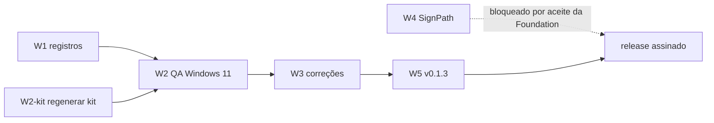

# Plano da plataforma Windows — simpleMD (p-windows, 2026-11-10)

Base: `main` `112dabc` (CI 42792289991 verde), versão 0.1.2, 48 commits depois da tag `v0.1.2`.
Insumos: relatórios dos scouts WinBacklog, WinFeatureCoverage e WinRelease (sessão de 2026-11-10).

## Decisões (ask de 2026-11-10, expirado → opções recomendadas)

- D-PW-01: começar pela QA interativa no PC Windows 11 IoT Enterprise LTSC 10.0.26300; os achados alimentam as correções.
- D-PW-02: assinatura do Windows pela SignPath Foundation; fechar o PR #24 e refazer sobre a `main`. O editor exibido passa a ser "SignPath Foundation" (WS-3); `bundle.publisher` continua "Rafael Brauner" (N17, chave HKCU).
- D-PW-03: distribuição: só o pré-lançamento v0.1.3 depois da QA. Fora do plano por ora: auto-update (portão AS-R5-M07), winget e ARM64.
- D-PW-04: sem conta OneDrive de teste → os roteiros de nuvem (r26/r36, `docs/qa/nuvem.md`) ficam NOT_TESTED até haver conta.

## Artefatos de entrada (dry-run 42802659203, `112dabc`, não publicados)

| Arquivo                                                                                      | sha256                                                             |
| -------------------------------------------------------------------------------------------- | ------------------------------------------------------------------ |
| `~/Downloads/simpleMD-main-112dabc/bundle-dry-run-windows/nsis/simpleMD_0.1.2_x64-setup.exe` | `f9b3d0d52481ca2b8631566576303251f1fd738bfbff37b3606bddadf5297cf6` |
| `…/bundle-dry-run-windows/msi/simpleMD_0.1.2_x64_en-US.msi` (não usar)                       | `ac32ce60afd12972811b41d4060f50417d7de1c36137f1e694b094c7bc0643e1` |
| `…/bundle-dry-run-macos/dmg/simpleMD_0.1.2_aarch64.dmg`                                      | `5410e61c21654dc1ae11ae1f16d93288f9deefb945604864f1e7b1aa7bcca907` |

Os três sha256 são iguais aos do passo "SHA-256 dos pacotes" no log do CI. O artefato expira em 7 dias (até 2026-11-17).

## W1 — Registros (perfil `lite`, só `.md`, 3 arquivos)

- `TAREFAS_PENDENTES.md`: um item "QA Windows 11 de r26–r42" com a lista do W2; T:213 (r27b) passa a `[x]` (PR #85); o desvio D1 vira "Windows 11 IoT LTSC 26300 a partir do p-windows".
- `MELHORIAS.md`: M:51 obsoleto (já há máquina Windows); F-WIN-03 a remedir no Windows 11.
- `docs/qa/windows-protocol.md`: seção nova para r26–r42 (tabela abaixo), PC Windows 11; depois recopiar para `vm/docs/` do kit (AC-W05.12).

## W2 — Sessão de QA no Windows 11 (usuário + QA; sem código)

Pré-requisitos do usuário, num ask só no início da sessão: PC ligado, forma de acesso (SSH `10-habilitar-ssh.ps1` ou ao vivo), confirmar se a pasta `smd-winqa-teste` sumiu do OneDrive (T:133), apagar o backup do `runner.ps1` no Kaspersky (INC-R5D-01).

W2-kit (DevOps, fora do repo): `make-kit.sh --rev 112dabc`; o controle `569ef72` continua; fixtures novas: `.dic`+`.aff` cp1252 e `.txt` para o r33, vault de busca (`FX-SEARCH` exportado do harness), nota com junção para o r37.

| #   | Verificação                                                                                                                                                       | Origem                    | Precisa de                                     |
| --- | ----------------------------------------------------------------------------------------------------------------------------------------------------------------- | ------------------------- | ---------------------------------------------- |
| 1   | Atualizar a 0.1.2 instalada pelo `-setup.exe` do 112dabc (mesma versão: confere sobrescrita), SmartScreen e o estado do Smart App Control em Segurança do Windows | T:142, M:508              | —                                              |
| 2   | Critérios 1–6 refeitos no Windows 11 (fecha o D1)                                                                                                                 | T:13–48                   | —                                              |
| 3   | Ctrl+E (com o Vim), Ctrl+\, Ctrl+Shift+D, Ctrl+Shift+G e Ctrl+Space/Ctrl+Shift+Space no teclado físico ABNT2                                                      | T:130, T:214, F-WIN-03    | —                                              |
| 4   | Tema "Sistema" acompanhando o modo de apps do Windows ao vivo                                                                                                     | r28                       | —                                              |
| 5   | Dicionários: camada global em `%APPDATA%`, importar `.dic` cp1252, `.lnk` no diálogo, renomear                                                                    | r32/r33                   | —                                              |
| 6   | Ortografia offline com o motor real (não o falso do CI)                                                                                                           | r34/r35                   | —                                              |
| 7   | Busca no texto no WebView2 real, com junção na pasta                                                                                                              | r37, R37C-WINDOWS-REAL    | —                                              |
| 8   | Prévia lado a lado e editor dividido com o NVDA                                                                                                                   | r38/r39                   | NVDA                                           |
| 9   | Diálogo nativo "Permitir nesta sessão" (TaskDialog, regra de 1 s) e consentimento por pasta                                                                       | r30/r31, critério 7       | Ollama ou chave de teste; sem eles, NOT_TESTED |
| 10  | Sonda WebRTC/`preconnect` com o WebView2 157 e controle A/B                                                                                                       | AS-R4-05                  | listener do kit                                |
| 11  | `open_url` interativo (Ctrl-clique em https/mailto)                                                                                                               | T:158                     | —                                              |
| 12  | `cargo test` `junction_refused` e o resto local no PC                                                                                                             | T:159                     | Rust no PC (opcional)                          |
| —   | OneDrive: r26 (versões, arquivo preso pelo Word) e r36 (`cloudOnly`)                                                                                              | M:360, `docs/qa/nuvem.md` | conta de teste: NOT_TESTED (D-PW-04)           |

Saída: `.nexus/runs/p-windows/qa/report.md` + `SHA256SUMS`; cada linha PASS/FAIL/NOT_TESTED com evidência.

## W3 — Correções de código (implementer; uma fatia por run, perfil pela triagem)

Já conhecidas; o W2 pode acrescentar ou reordenar.

| Fatia | Itens                                                                                                                                                                                       | Arquivos (estimativa)                                                                                             | Perfil provável  |
| ----- | ------------------------------------------------------------------------------------------------------------------------------------------------------------------------------------------- | ----------------------------------------------------------------------------------------------------------------- | ---------------- |
| W3a   | N-3 / AS-R9-01: `COM¹–³`, `LPT¹–³`, `CONIN$`, `CONOUT$`, "nul .md" com paridade TS + Rust                                                                                                   | `vault/policy.rs`, `packages/vault/src/path.ts` + testes (≤ 4)                                                    | `micro`/`patch`  |
| W3b   | RR-02: flush depois do diálogo também no "Fechar sem salvar"                                                                                                                                | `apps/desktop/src/state/sync.ts` + teste (2)                                                                      | `micro`          |
| W3c   | R26-RENAME-ERRNO (`replace.rs:128`), TA-R2-10 (junção na leitura, `ops.rs:260`), DF-03 (`send_error` sem depender do SO)                                                                    | `vault/replace.rs`, `vault/ops.rs`, `lt/*.rs` (≤ 4)                                                               | `patch`          |
| W3d   | SN-SEC-06: hard links e nomes 8.3 em `vault_read_image`/`vault_read_file` (`GetFileInformationByHandle`, `GetLongPathNameW`)                                                                | `vault/image.rs`, `vault/ops.rs` + testes `cfg(windows)` (≤ 4)                                                    | `patch` + AppSec |
| W3e   | Portões: AS-R4-01 (2ª chamada de `additional_browser_args`), IMP-W01-2 (regex multilinha), CR4-W01-4 (`WEBVIEW2_ARGS` no `simplemd.exe` do `desktop-build`), N16 (fixar `bundle.publisher`) | `scripts/check-tauri-security.mjs`, `scripts/check-ci-supply-chain.mjs`, `.github/workflows/ci.yml`, testes (≤ 5) | `lite`           |

Fora do plano (seguem em `MELHORIAS.md`): CR2-04 (corrida em pasta intermediária, G), R26-JANELA/R26-METADADOS (ACL/ADS na troca), tauri-driver e2e no WebView2 real (G).

## W4 — Assinatura SignPath (DevOps + usuário; bloqueada pelo aceite da Foundation)

Ações do usuário (externas): MFA no GitHub e no SignPath, pedido em signpath.org/apply, papéis Authors/Reviewers/Approvers, projeto `simpleMD` com a política `release-signing`, segredo `SIGNPATH_API_TOKEN` e variável `SIGNPATH_ORGANIZATION_ID` no Environment `release`, liberar `signpath/github-action-submit-signing-request` na lista de ações (SHA fixado).

Código (DevOps, perfil `feature`), sobre a `main`:

1. Fechar o PR #24; aproveitar `.signpath/artifact-configurations/*.xml`, `scripts/assert-installer-embeds-exe.mjs` e o formato de 4 passos dos jobs.
2. WS-4: hoje o `publish` espera o `sign-macos`, que sempre falha fechado (macOS sem Developer ID). É preciso um caminho "Windows assinado + macOS ad-hoc", que muda as exceções de escrita do `check:ci`.
3. `bundle-windows`: `NotSigned` → `Valid` (D-R18-03); a assinatura num job isolado fecha o R18-EXE-AUTODECLARADO.
4. README: seção "Code signing policy" (texto fixo da Foundation + frase de privacidade); F-2 (`CompanyName`/`LegalCopyright`).

## W5 — Pré-lançamento v0.1.3 sem assinatura (depois do W2 PASS e do W3)

Corte por PR (versão nos 4 manifestos, CHANGELOG `[Não lançado]` → `[0.1.3]`, README "Instalar"), CI verde, tag `v0.1.3` (admin), `gh workflow run release.yml --ref v0.1.3 -f unsigned_prerelease=true`, aprovação no Environment `release`, conferência do rascunho e publicação. Publicar exige o "vai" do usuário (CONTRATO §5). Limpeza: o rascunho órfão "simpleMD 0.1.2" (Draft, 2026-11-08T22:45:43Z) — apagar só com confirmação.

## Pendências do usuário que o plano não resolve

- Ollama ou chave de teste para o critério 7 no Windows.
- Conta OneDrive de teste (D-PW-04).
- Defender (WIN-R5-05): o PC usa Kaspersky.
- Conferir no PC que o `sshd` está parado e a chave `smd-winqa` saiu (S-R4-01).
